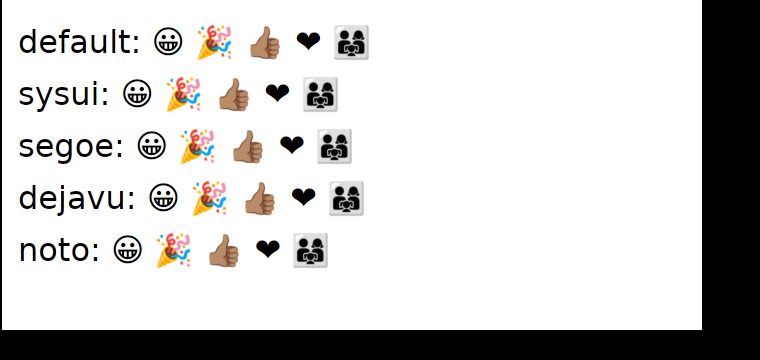

# GLIN-01: эмодзи и перетаскивание файлов наружу на Linux

Проверочные программы — `GLIN-01/check/` (не крейт: собрать во временном проекте с `gpui-kit = "=0.9.1"` и
`[patch.crates-io]` на `crates/pets-gpui-linux` и `crates/pets-gpui-wgpu`, `dnd.rs` — в `src/bin/`, нужен `env_logger`).
Пакеты: `xvfb imagemagick xdotool fonts-noto-color-emoji mesa-vulkan-drivers` (lavapipe — wgpu без GPU).

## Эмодзи (снимок под Xvfb)

1. `check/shot.sh ./target/debug/emo out.png` — окно с пятью строками разных шрифтов: 😀 🎉 👍🏽 ❤️ 👨‍👩‍👧.
2. Ожидание: все пять — цветные (Noto Color Emoji), в т. ч. 😀 и ❤️.

| До (gpui-pre-wgpu 0.3.12) | После (Pets patch) |
|---|---|
|  |  |

До: 😀 и ❤ — одноцветные контуры DejaVu Sans (cosmic-text берёт его раньше Noto Color Emoji). На системе, где
первым в списке замен стоит шрифт без нужного глифа или с пустым, эмодзи не видно совсем.

## Перетаскивание наружу, X11 (автоматически под Xvfb)

1. `BIN=./target/debug/dnd check/dnd.sh` — два процесса: источник (оранжевый квадрат) и приёмник (зелёное окно,
   gpui — тоже клиент XDND). xdotool зажимает кнопку на квадрате и ведёт указатель в приёмник.
2. Ожидание: в `dst.log` — `DROPPED ["/tmp/glin-01-payload.txt"]`, в `src.log` — `XDND: drag ended (dropped: true)`.
   Прогон 2026-11-12: так и есть.

## Вручную на рабочем столе (X11 и Wayland)

1. Postman: открыть письмо с вложением, потянуть вложение из окна в Nautilus/Dolphin/Thunar.
2. Ожидание: файл скопирован в каталог; курсор над окном, которое не принимает файлы, — отказ; Esc (X11) — отмена.
3. Бросить вложение обратно в окно Postman — на X11 ничего не происходит (отмена), на Wayland — как upstream gpui.
4. Повторить в сеансе Wayland (GNOME, KDE): путь `wl_data_device` — upstream gpui, здесь не проверялся.
